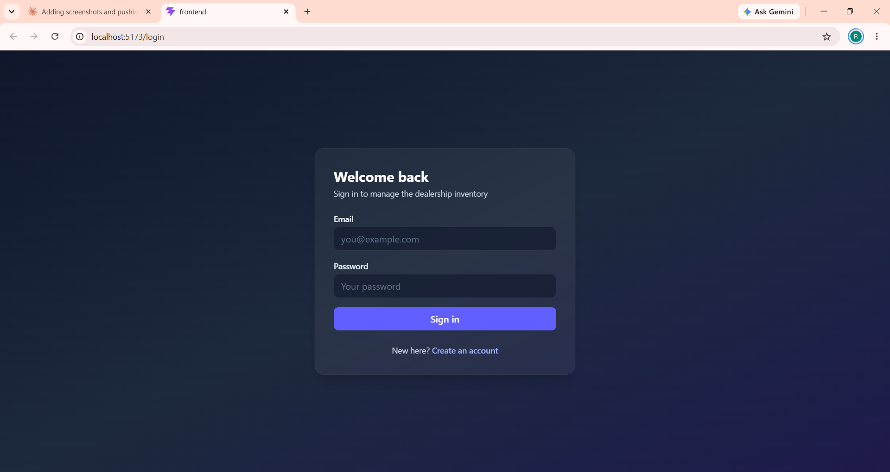
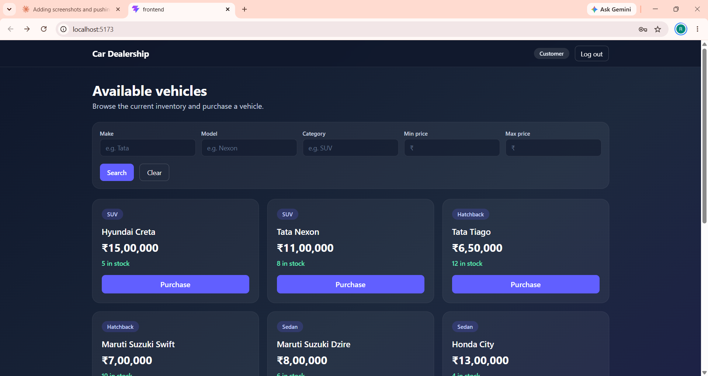
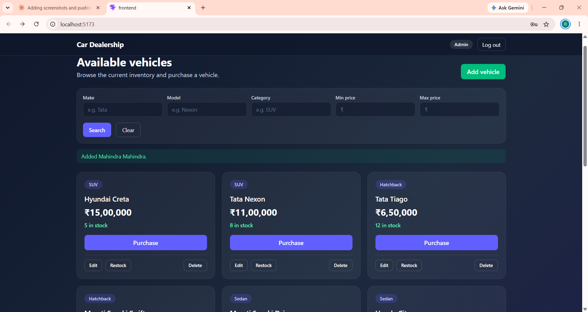
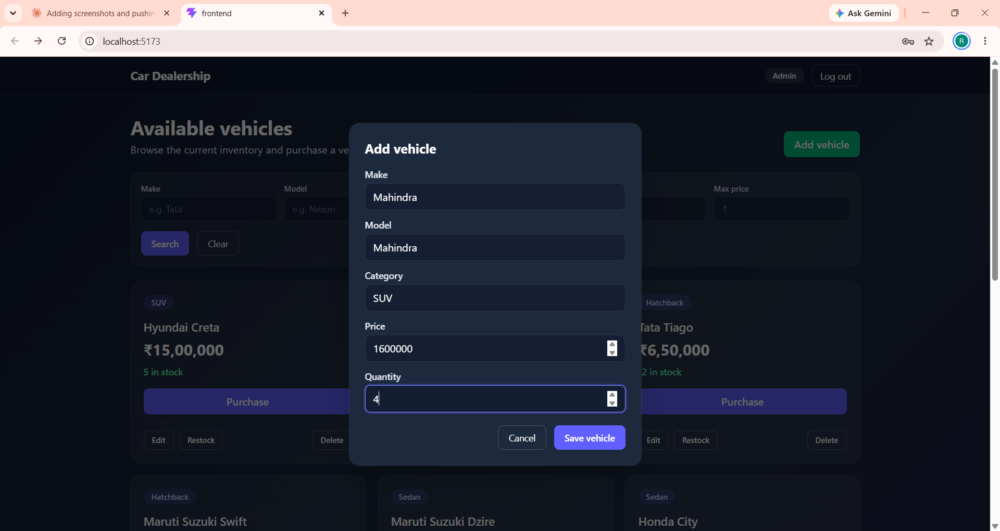

# Car Dealership Inventory System

A full-stack inventory app for a car dealership, built as a TDD kata.
Customers can browse, search and purchase vehicles. Admins can also add, edit, delete and restock them.

- **Live demo:** _not deployed_ (run it locally using the steps below)
- **API docs (Swagger):** run the backend locally and open http://127.0.0.1:8000/docs

## Tech stack

| Layer | Technology |
|---|---|
| Backend | Python 3.13, FastAPI, SQLAlchemy |
| Database | SQLite (file-based, persistent) |
| Auth | JWT (PyJWT), passwords hashed with bcrypt |
| Backend tests | pytest, pytest-cov, FastAPI TestClient |
| Frontend | React (Vite), Tailwind CSS, React Router, Axios |
| Frontend tests | Vitest, React Testing Library |

## Features

- Register and log in; JWT-protected API
- Role-based access: `user` and `admin` (roles are never accepted from client input)
- Vehicles with unique ID, make, model, category, price and quantity in stock
- Search by make, model, category and price range
- Purchase decreases stock atomically; the button is disabled at zero stock
- Admin panel in the UI to add, edit, delete and restock vehicles (delete and restock are also enforced as admin-only in the API)
- Form validation, delete confirmation and restock amount validation
- Loading, empty and error states throughout the UI

## API endpoints

| Method | Endpoint | Access |
|---|---|---|
| POST | `/api/auth/register` | Public |
| POST | `/api/auth/login` | Public |
| GET | `/api/vehicles` | Logged in |
| POST | `/api/vehicles` | Logged in |
| GET | `/api/vehicles/search` | Logged in |
| PUT | `/api/vehicles/:id` | Logged in |
| DELETE | `/api/vehicles/:id` | **Admin** |
| POST | `/api/vehicles/:id/purchase` | Logged in |
| POST | `/api/vehicles/:id/restock` | **Admin** |

## Running locally

Requirements: Python 3.11+, Node.js 18+, Git.

### Backend

```bash
cd backend
python -m venv venv
venv\Scripts\activate          # macOS/Linux: source venv/bin/activate
pip install -r requirements.txt
python -m app.seed             # creates demo users and sample vehicles
uvicorn app.main:app --reload
```

The API runs at http://127.0.0.1:8000 (docs at `/docs`).

### Frontend

```bash
cd frontend
npm install
npm run dev
```

The app runs at http://localhost:5173. To point it at a different API, set `VITE_API_URL`.

### Demo accounts (created by the seed script)

| Role | Email | Password |
|---|---|---|
| Admin | admin@example.com | Admin@12345 |
| User | user@example.com | User@12345 |

These are demo credentials only. Override the admin with the `ADMIN_EMAIL` and `ADMIN_PASSWORD` environment variables.

### Environment variables (all optional locally)

| Variable | Purpose |
|---|---|
| `DATABASE_URL` | Database connection (default: local SQLite file) |
| `SECRET_KEY` | JWT signing key (**set this in production**) |
| `CORS_ORIGINS` | Comma-separated allowed frontend origins |
| `SEED_ON_STARTUP` | `true` to seed demo data when the server starts |
| `VITE_API_URL` | Backend URL used by the frontend |

## Screenshots

### Login



### Customer dashboard

Customers can search and purchase vehicles, and see no admin controls.



### Admin dashboard

Admins also get the **Add vehicle** button and Edit, Restock and Delete buttons on every card.



### Add vehicle form (admin)



## Testing

```bash
# Backend (from /backend)
python -m pytest

# Frontend (from /frontend)
npm test
```

### Test report

- **Backend:** 63 tests passing, 100% statement coverage. Full output: [`reports/test-report.txt`](reports/test-report.txt)
- **Frontend:** all tests passing (Vitest + React Testing Library). Run `npm test` in `/frontend` for the current count.

Tests were written before the implementation (red, then green) for the backend and frontend features. The commit history shows each `test:` commit followed by a `feat:` commit.

Note on history: the vehicle API tests were first committed together with their implementation, so that feature has no separate red commit. Every later feature has one.

## Design decisions

- **Layered backend:** routers handle HTTP, services hold business logic, models hold persistence.
- **Atomic stock changes:** purchase and restock use a single SQL `UPDATE`, so two buyers cannot take the last unit.
- **Security:** bcrypt password hashing, JWT expiry, roles read from the database on each request, and no role field accepted at registration.
- **Configuration through environment variables**, so deployment needs configuration only, not code changes.
- **Database constraints** (`price > 0`, `quantity >= 0`) in addition to API validation.
- **Reusable modal component** shared by the add/edit, delete and restock dialogs, with Escape-to-close.

## Known limitations

- SQLite on free hosts with ephemeral disks can lose data on restart; the seed script restores demo data.
- When a token expires, the UI shows a generic error rather than redirecting to login.
- The app is not deployed; it is run locally.

## My AI Usage

**Tools used:** Claude (Anthropic) in the Claude chat interface.

**How I used it:**
- Discussed the architecture and technology choices (FastAPI, SQLite, React, Tailwind)
- Generated the first draft of the project setup, tests, backend code and React components
- Debugged errors by pasting terminal output (for example, import path mistakes and Windows test worker timeouts)
- Used it to plan the red-green-refactor order for each feature

**What I did myself:** ran every test, committed each red and green step, checked behaviour in the browser, fixed environment problems on my machine, and decided which features and rules to build.

**Reflection:** AI sped up the boilerplate the most: project setup, test scaffolding and the React components came together much faster than writing them by hand. It got some environment details wrong, such as import paths and test settings that timed out on Windows, and I had to paste the errors back and fix them on my machine. Working in red-green steps taught me to write the failing test first and to read the output carefully instead of trusting generated code. I checked each feature in the browser myself, because passing tests alone did not prove the screens looked right.

Every AI-assisted commit carries a `Co-authored-by` trailer. The full chat log is in [`PROMPTS.md`](PROMPTS.md).
